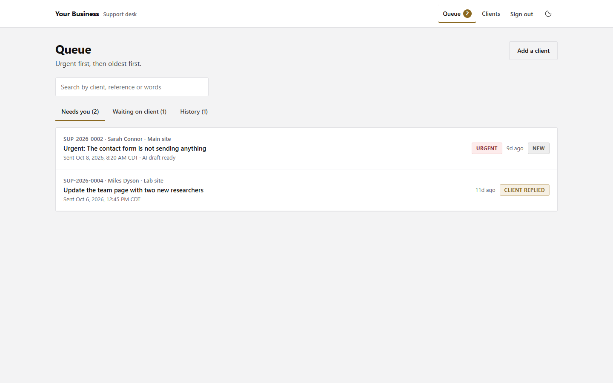

# Support Desk

A self-hosted support desk for freelancers and small studios. Clients send requests with files, links and voice notes. You manage the queue, keep private notes, and reply from one conversation.

Built by [Diane Whiddon](https://github.com/dianewhiddon), adapted from the support system she uses at Sway Rise Creative. This standalone edition contains no client records or connections to that system. Licensed under [MIT](LICENSE.md), including commercial use.



## What it does

- **Client sign-in by email.** Only addresses you add can sign in. Links expire after 30 minutes and work once, with a confirmation step to protect them from email scanners.
- **Requests and conversations.** Changes, questions and urgent requests, with up to six attachments and browser-recorded voice notes. Clients see their own requests and published replies.
- **One owner queue.** Needs you, Waiting on client, History. Search, urgency, saved drafts, private notes, reply attachments and resolution history.
- **Recoverable notifications.** Request and reply emails are recorded with their messages. Delivery receipts appear in the desk; retry failures from the saved notification.
- **Optional AI drafts.** Ask Claude for a draft, review it, then send. AI is off by default. It has no tools and cannot edit a website.
- **Optional agent API.** A trusted coding agent can read requests, save drafts and notes, and send a saved reply. The [agent guide](docs/AGENTS.md) explains its authority and review requirements.
- **Light and dark themes.** Neutral surfaces, gold actions, keyboard navigation and responsive layouts. Change the theme in one stylesheet.

[See the client request form](docs/screenshots/client-request.png).

## Try it locally

Use Node **22.12 or newer** (Node 24 LTS recommended) and npm. The lockfile is included.

```sh
npm ci
npm run build
npm run demo
```

Open **http://127.0.0.1:8899/admin** for the queue or **http://127.0.0.1:8899/dashboard** for the client view. This read-only demo uses fictional data in a temporary local database. It cannot send email, call AI or accept changes. Stop it with Ctrl+C.

For working forms and sign-in, follow [local setup](docs/SETUP.md). No cloud credentials are required to run the local app or its tests.

## Host your own

The stack is **Astro + Cloudflare Workers**, **D1** for records, **private R2** for files, and **Resend** for email. You need your own accounts and domain. Anthropic is optional. Provider charges and quotas depend on your usage; this repository includes no hosted service.

[Setup and deployment](docs/SETUP.md) covers configuration, first-admin access, database migrations, email verification and GitHub main → Workers Builds. [Operations](docs/OPERATIONS.md) covers backups, recovery, updates and retention.

## Development

```sh
npm run verify
```

Runs lint, formatting checks, behavioral tests, Astro checks and the production build. Tests use the real SQL migrations with an in-memory SQLite adapter and an R2 test double. They exercise access boundaries, file validation, stale revisions, duplicate submissions, authentication and email failures. [Architecture](docs/ARCHITECTURE.md) maps the modules and tradeoffs.

## Security and limits

This is a single-business desk, not a multi-tenant SaaS. Every administrator and agent token has access to all clients. Files are checked structurally and served with restrictive headers; this is **not antivirus scanning**. Review downloaded files before opening them. AI output is untrusted and must be reviewed. The app cannot prove that an agent obtained human approval in a separate chat.

There is no hosted auto-fix executor, billing, SLA scheduler, voice transcription or analytics suite. See [security and privacy](SECURITY.md) before collecting real client information.

## Contribute

Issues and focused pull requests are welcome. Contributions are voluntary under MIT. Start with [CONTRIBUTING.md](CONTRIBUTING.md); report vulnerabilities privately as described in [SECURITY.md](SECURITY.md).
